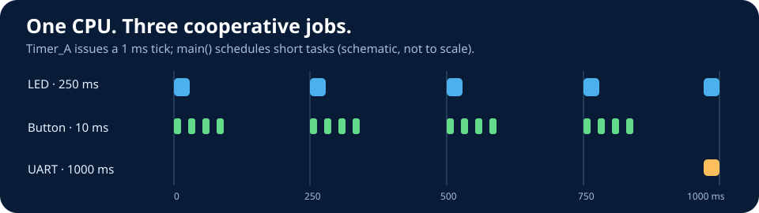

# Lesson 11 — A Multitasker You Can Understand

**From busy waiting → explicit Timer_A scheduling → friendly `RUN_EVERY` macros → low-power measurement.**



This lesson is *cooperative scheduling*, not an RTOS or preemptive multitasking. It takes advantage of the MSP430G2553's 16-bit Timer_A hardware, not independent stacks. The system has **512 bytes RAM and 16 KB flash**: a small teaching scheduler is appropriate.

## What students make

One program carries three activities: (1) an LED heartbeat about every 250ms, (2) button sampling/debouncing every 10ms with a second LED indicating accepted presses, and (3) once-per-second UART counts at **9600 baud**. The old original G2 and newer G2ET use P1.0, P1.6, and P1.3 for these onboard signals. LED **colors can differ**; refer to `LED_A` and `LED_B` by pin.

| Stage | Entry point | Teaching question |
| --- | --- | --- |
| 1. Blocking | [01-blocking/main.c](01-blocking/main.c) | Why do short presses get lost during busy delays? |
| 2. Registers | [02-explicit-timer/main.c](02-explicit-timer/main.c) | How does the ISR tick let three jobs share one loop? |
| 3. Macro | [03-run-every-macro/main.c](03-run-every-macro/main.c) | What *exactly* does `RUN_EVERY` expand to? |
| 4. EnergyTrace (optional) | [04-energytrace/main.c](04-energytrace/main.c) | What changes when we sleep between timer events? |

## The deliberate macro progression

Stage 2 says:

```c
if ((uint16_t)(now - led_at) >= 250u) {
    led_at = now;
    P1OUT ^= BIT0;
}
```

Stage 3 says:

```c
RUN_EVERY(led_job, now, blink_led);
```

The macro expands into a **small ordinary C `if`**, and `job_is_due()` performs the elapsed-time subtraction. Open [`03-run-every-macro/tiny_scheduler.h`](03-run-every-macro/tiny_scheduler.h) to see *every line*. The LED function ultimately does `P1OUT ^= BIT0;`. **Readable vocabulary, transparent registers.**

## Working with CCS (old G2 and newer G2ET)

Each stage is a **standalone C source set** with a TI `.projectspec` import candidate. Import the stage-specific `.projectspec` in CCS or create *one* empty MSP430G2553 C project and add **only** the files from that stage directory. Stage 1/2: `main.c`, `edu430.h`. Stage 3/4: also add `tiny_scheduler.h` and `button_filter.h`. Do **not** add different stages to one project; all contain `main()`. The ProjectSpecs are not yet physically import-tested in CCS. See [CCS stage instructions](CCS_PROJECTS.md) and main course [setup guide](../../docs/CCS_SETUP.md).

The code uses the board's 1 MHz factory DCO calibration; CPU MCLK and Timer_A SMCLK are 1 MHz. `TA0CCR0=999` gives a 1 ms timer interrupt. Select board-specific programmer, set old board hardware UART jumpers correctly, and use Windows's backchannel COM port at **9600 8N1**. The newer G2ET is preferred for EnergyTrace; the old debugger is less compatible with recent IDEs.

## Caveats (part of the lesson)

- Scheduler period accuracy depends on clock calibration and how long each job takes. UART output uses a blocking transmitter and slightly increases jitter.
- The 16-bit time counter wraps every 65.536s. Unsigned subtraction works across one wrap **if the loop keeps running**, with each task period well below 65s. Do not block main for an entire wrap.
- The `job_is_due()` function resets the timestamp to **now**, rather than executing a burst of overdue tasks; it skips missed periods if a task overruns. This is intentional.
- The button debounce accepts a new press after about three equal samples at 10ms; stage 1 has no debounce.
- EnergyTrace requires G2ET measurement hardware and proper eZ-FET connection. G2553 supports **EnergyTrace**, not EnergyTrace++ internal-state tracing.
- Stage 4 has compile-time toggles `IDLE_LOW_POWER`, `POWER_TEST_LED`, and `POWER_TEST_UART`. Keep the latter two identical when comparing energy.
- **LPM0**, not LPM3, retains SMCLK; this design needs SMCLK to tick the timer. Every 1ms the ISR wakes the CPU, so the power benefit is deliberately modest and must be *measured*, not assumed.

**Tests:** `python3 tools/check_sources.py` from repository root, and `sh lessons/11-tiny-multitasker/tests/run_host_tests.sh` for deterministic scheduler and switch behavior. These are **host-side tests only**; TI CCS build and G2/G2ET physical testing are required before claiming verified hardware performance.

Read [Teacher Notes](TEACHER_NOTES.md) for learning outcomes, inquiry investigations, misconceptions, EnergyTrace protocol, and assessment.
